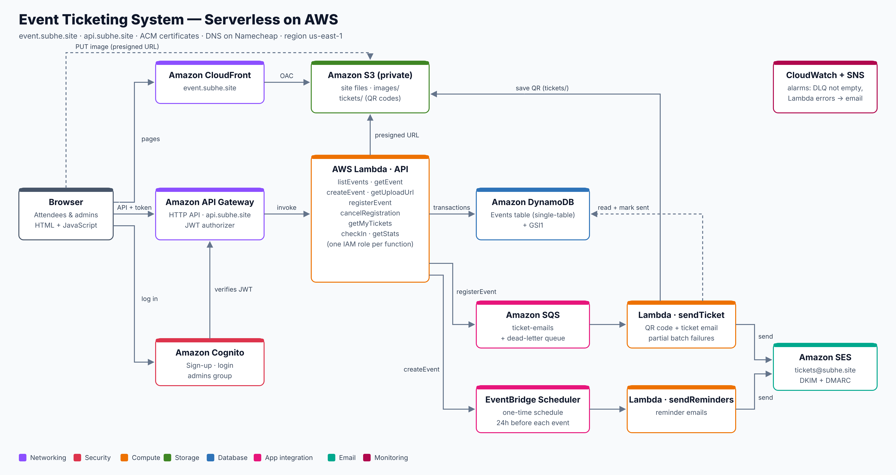
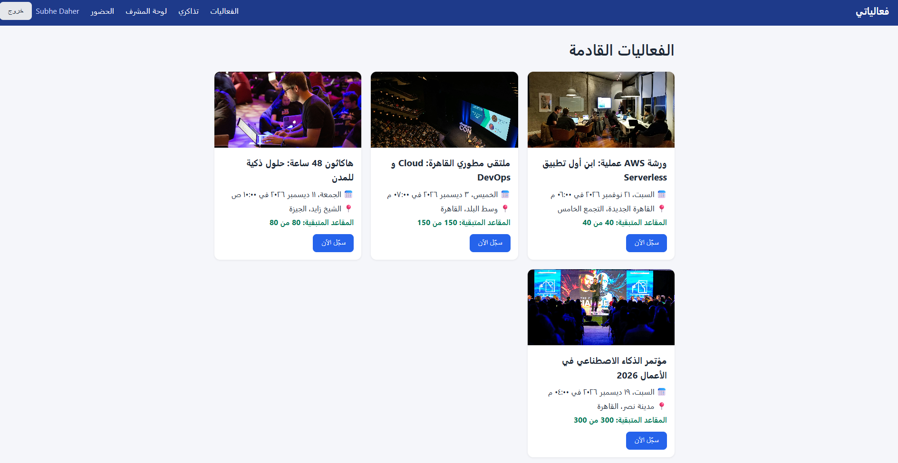
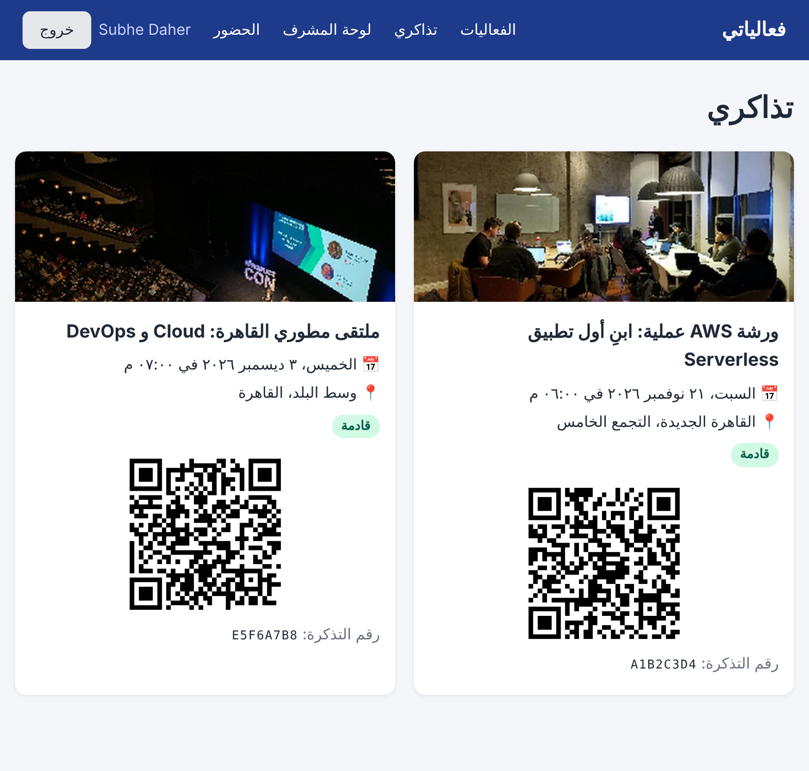
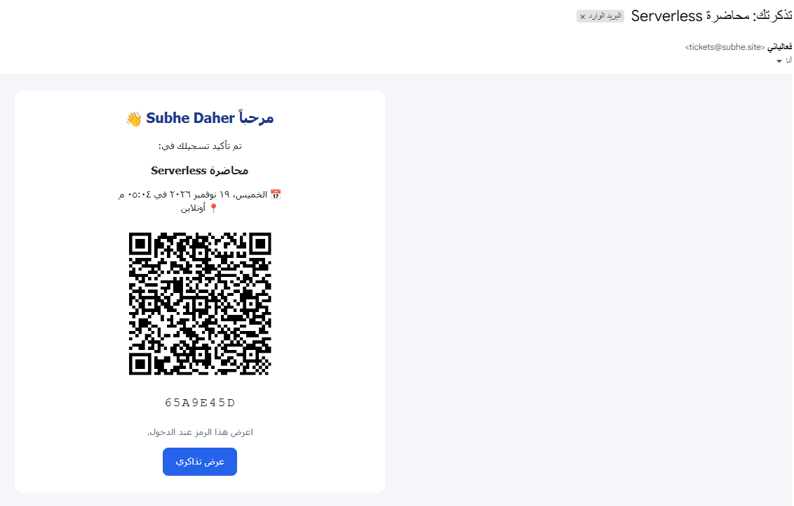
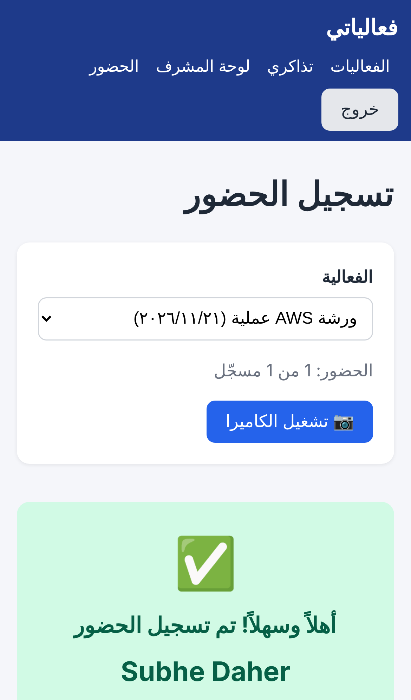
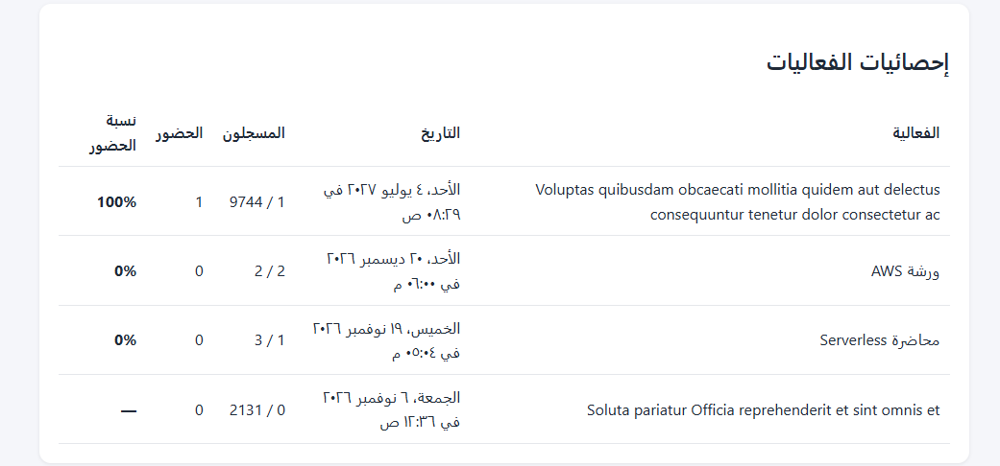
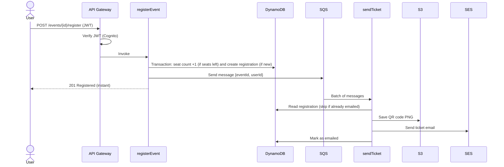

# 🎟️ Event Ticketing System — Serverless on AWS

A full event registration and ticketing platform built entirely on AWS serverless services.
Users sign up, register for events, receive a QR code ticket by email, get a reminder 24 hours before the event, and are checked in at the door by scanning their QR code.



## 📸 Screenshots

| Upcoming events | My tickets |
| --- | --- |
|  |  |

| Ticket email (QR code) | Reminder email |
| --- | --- |
|  |  |

| Check-in on a phone | Admin stats |
| --- | --- |
|  |  |

---

## ✨ Features

**Attendees**
- Sign up and log in (email verification)
- Browse upcoming events with live seat availability
- Event details page with a shareable link (copy, WhatsApp, add to Google Calendar)
- Register and cancel with one click
- Receive a ticket email with a QR code
- Receive a reminder email 24 hours before the event
- "My Tickets" page with QR codes and attendance status

**Admins**
- Create events with an image
- Scan tickets with the phone camera to check people in
- Stats per event: registered, checked in, attendance rate

**Operations**
- Email alerts when a ticket email fails or a Lambda function errors

---

## 🧱 AWS Services

| Service | Used for |
| --- | --- |
| **Amazon S3** | Private bucket for the website, event images, and QR codes |
| **Amazon CloudFront** | HTTPS delivery of the site with Origin Access Control (OAC) |
| **Amazon API Gateway** (HTTP API) | 9 REST routes on a custom domain, JWT authorizer |
| **Amazon Cognito** | Sign-up, login, email verification, `admins` group |
| **AWS Lambda** (Node.js) | 11 functions, each with its own least-privilege IAM role |
| **Amazon DynamoDB** | Single-table design with one Global Secondary Index |
| **Amazon SQS** | Queue for ticket emails, with a dead-letter queue |
| **Amazon EventBridge Scheduler** | One-time reminder schedule per event |
| **Amazon SES** | Transactional email from `tickets@subhe.site` (DKIM + DMARC) |
| **AWS Certificate Manager** | Free TLS certificates for both custom domains |
| **Amazon CloudWatch + SNS** | Logs, alarms, and email alerts |

---

## 🔄 How a registration works



---

## 🧠 Key Design Decisions

### 1. Single-table DynamoDB design
Events and registrations live in one table. An event and all its registrations share the same partition key, so one `Query` returns everything about an event.

| Item | PK | SK | GSI1PK | GSI1SK |
| --- | --- | --- | --- | --- |
| Event | `EVENT#<id>` | `META` | `EVENTS` | `<date>` |
| Registration | `EVENT#<id>` | `REG#<userId>` | `USER#<userId>` | `EVENT#<id>` |

`GSI1` is **overloaded** to answer two different questions:
- `GSI1PK = EVENTS` → all events sorted by date (home page, admin stats)
- `GSI1PK = USER#<id>` → all tickets of one user ("My Tickets")

**No `Scan` anywhere in the code.**

### 2. No overbooking, no double registration
`registerEvent` uses a **DynamoDB transaction** with two conditions:
1. Increase `registeredCount` **only if** it is below `capacity`
2. Create the registration **only if** it does not exist yet

Both succeed or both fail, so even 100 requests in the same second cannot exceed the seat limit (no race condition).

### 3. Tickets that work only once
`checkIn` uses a transaction that marks the ticket as used **only if** the ticket ID matches and it was not used before. It also uses `ReturnValuesOnConditionCheckFailure` to explain *why* a scan failed (already used, old ticket, cancelled) without an extra read.

### 4. Decoupled emails with SQS
Registration returns immediately; the ticket email is sent in the background.
- **Dead-letter queue** after 3 failed attempts, with a CloudWatch alarm
- **Idempotent worker:** a duplicate message never sends a second email
- **Partial batch responses:** only failed messages are retried

### 5. Direct image uploads with presigned URLs
Admins upload images straight from the browser to S3 using a 5-minute presigned URL. The `Content-Type` is part of the signature, so only images can be uploaded, only to `images/`.

### 6. Scheduled reminders without polling
When an event is created, `createEvent` creates a **one-time EventBridge schedule** 24 hours before the event. The schedule deletes itself after it runs (`ActionAfterCompletion: DELETE`). No cron job running all day.

### 7. Security
- **Private S3 bucket**, readable only by this CloudFront distribution (OAC + `AWS:SourceArn` condition)
- **JWT authorizer** rejects invalid tokens before any Lambda runs; admin routes also check the `admins` group inside the function
- **One IAM role per function** with only the actions and resources it needs
- `iam:PassRole` limited to one role and one service (prevents privilege escalation)
- Default API Gateway endpoint **disabled**; only the custom domain works
- CORS limited to the site's domain; TLS 1.2 minimum
- All user input validated in Lambda; user data escaped in HTML and emails

---

## 🔌 API

| Method | Path | Access | Function |
| --- | --- | --- | --- |
| GET | `/events` | Public | `listEvents` |
| GET | `/events/{id}` | Public | `getEvent` |
| POST | `/events` | Admin | `createEvent` |
| POST | `/events/{id}/upload-url` | Admin | `getUploadUrl` |
| POST | `/events/{id}/register` | User | `registerEvent` |
| DELETE | `/events/{id}/register` | User | `cancelRegistration` |
| GET | `/me/tickets` | User | `getMyTickets` |
| POST | `/checkin` | Admin | `checkIn` |
| GET | `/admin/stats` | Admin | `getStats` |

Background functions: `sendTicket` (SQS trigger), `sendReminders` (EventBridge Scheduler).

---

## 📁 Project Structure

```
backend/                 Lambda functions (Node.js, AWS SDK v3)
  utils.mjs              shared helpers (auth claims, responses, errors)
  *.mjs                  one file per function
frontend/                static site (HTML + vanilla JavaScript)
  index.html             events
  login.html             sign-up / login / confirm
  tickets.html           my tickets with QR codes
  admin.html             create events + stats
  checkin.html           camera QR scanner
  js/config.js           API URL, region, Cognito client ID
docs/                    architecture diagram, screenshots
```

---

## 🐛 Problems I Solved

| Problem | Cause | Fix |
| --- | --- | --- |
| `ValidationException: reserved keyword: capacity` | `capacity` and `date` are DynamoDB reserved words | Expression attribute names (`#cap`, `#d`) |
| Image uploads would fail | Newer AWS SDK adds a checksum of an empty body to presigned URLs | `requestChecksumCalculation: "WHEN_REQUIRED"` |
| Any file type could be uploaded | `Content-Type` was not signed | `signableHeaders: ["content-type"]` |
| `401 Unauthorized` with a valid login | Wrong Cognito client ID in the authorizer audience | Decoded the JWT and compared `aud` / `iss` |
| Registered event not shown right away | GSI reads are eventually consistent | Short delay before reloading |
| Broken Arabic text layout in Gmail | Gmail strips `dir` from `<html>` | Set `dir="rtl"` on the email container |
| Cancel button returned "not registered" after check-in | One transaction condition covered two different failures | `ReturnValuesOnConditionCheckFailure: ALL_OLD` to return the right message |
| A Lambda-errors alarm would miss failed ticket emails | The worker handles errors and returns `batchItemFailures`, so Lambda counts the run as successful | A separate alarm on the dead-letter queue |

---

## 💰 Cost

Everything is serverless and pay-per-use. With low traffic the monthly cost is a few cents (S3 storage, SES at $0.16 per 1,000 emails). Lambda, API Gateway, SQS, Scheduler, and Cognito stay within their free tiers.

---

## 🚀 Roadmap

- [ ] Infrastructure as Code with AWS SAM (one-command deploy)
- [ ] CI/CD with GitHub Actions
- [ ] Unit tests for the Lambda functions
- [x] SES production access (send to any email address)
- [ ] API Gateway `5xx` alarm

---

## 👤 Author

**Subhe Daher** — built while learning AWS serverless architecture.
